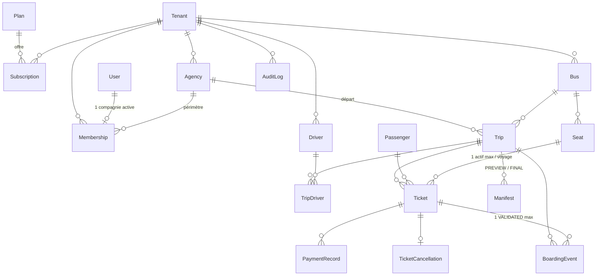

# Modèle de données

## Contraintes d'intégrité clés
| Contrainte | Rôle |
|---|---|
| `uniq_active_seat_per_trip` (partielle : billet ACTIVE avec siège) | pas de double attribution d'un siège |
| `uniq_validated_boarding_per_ticket` (partielle : résultat VALIDATED) | un billet ne s'embarque qu'une fois |
| `uniq_boarding_idempotency_key` (tenant + clé non vide) | rejeu réseau sans double effet |
| `uniq_*_per_tenant` (agence, bus, voyage, billet, manifeste) | unicités par compagnie |
| `uniq_manifest_version_per_trip` (voyage, type, version) | historique de versions |
| `one_active_membership_per_user` | 1 utilisateur = 1 compagnie active |

## Données personnelles
Passager : nom (obligatoire), téléphone (selon paramètre de la compagnie), pièce d'identité (facultative). Le QR n'en contient aucune ; l'audit n'enregistre ni jeton ni nom. Le manifeste archivé contient une copie des champs nécessaires (obligation de figer le document).
Conservation : **à définir avec la compagnie pilote selon la réglementation locale** (non automatisée dans le MVP : prévoir une tâche de purge/anonymisation des passagers de voyages anciens).
